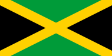
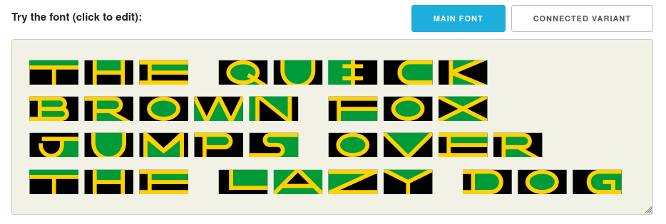
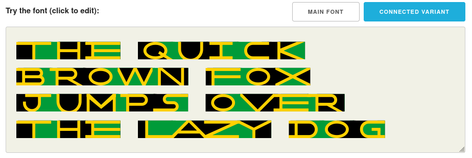

# Jamaican Flag Fonts

The Jamaican flag looks like the letter X.

<a href="https://bobbiec.github.io/jamaican-font.html"></a>

Inspired by [u/VelvetOnion’s Jamaican alphabet](https://www.reddit.com/r/vexillologycirclejerk/s/Bqage66kXN) - if that's X, what does the rest of the alphabet look like?

These two fonts turn that design into ordinary text you can type, select, copy, and search. The colors and shapes are built directly into the fonts.

**Jamaican Alphabet** displays each letter as an individual flag, with consistent spacing between letters.

[][try-online]

**Jamaican Connected** joins letters together, using contextual font features to match neighboring background colors and connect their gold strokes.

[][try-online]

[Try both fonts online][try-online], or read the [blog post][blog].

## Font features

The main font, Jamaican Alphabet, uses these font features:

| Feature        | Details                                                                                                                                                                                              |
| -------------- | ---------------------------------------------------------------------------------------------------------------------------------------------------------------------------------------------------- |
| A-Z characters | A–Z based on u/VelvetOnion's designs, with aliases for lowercase letters, and space. Note that digits and punctuation are not defined.                                                               |
| Colors         | Color palette is embedded into the font using [COLRv0](https://learn.microsoft.com/en-us/typography/opentype/spec/colr) and [CPAL](https://learn.microsoft.com/en-us/typography/opentype/spec/cpal). |

The connected variant makes some changes and uses more advanced font features:

| Feature                    | Details                                                                                                                                                              |
| -------------------------- | -------------------------------------------------------------------------------------------------------------------------------------------------------------------- |
| Full-height I/J/L/T shapes | These letters have updated shapes to support connecting them.                                                                                                        |
| Color switching            | Adjacent letters match colors with their neighbors by using contextual alternate (`calt`) forms (except for the letter X, which is always the original flag colors). |
| Joining glyphs             | Some combinations of letters also have `calt` forms that connect the lines when two adjacent letters share a corner.                                                 |
| Kerning                    | `kern` definitions are used to adjust the spacing between letters to improve their appearance.                                                                       |

See [Design and verification](docs/DESIGN.md) for geometry measurements, shaping references, and visual proofs.
I think there's plenty of room for improvement - I'm not a typography person so appreciate any suggestions on further changes to make.

## Quick start

The pre-built font files are included in `fonts/`. Copy them into your project and add the CSS:

```css
@font-face {
  font-family: "Jamaican Alphabet";
  src: url("fonts/JamaicanAlphabet.woff2") format("woff2");
  font-weight: 400;
  font-style: normal;
}
@font-face {
  font-family: "Jamaican Connected";
  src: url("fonts/JamaicanConnected.woff2") format("woff2");
  font-weight: 400;
  font-style: normal;
}
.jamaican,
.connected {
  font-synthesis: none;
  letter-spacing: 0;
  word-spacing: 0;
  line-height: 0.713;
}

/* font-family: sans-serif for digits and punctuation */
.jamaican {
  font-family: "Jamaican Alphabet", sans-serif;
}
.connected {
  font-family: "Jamaican Connected", sans-serif;
  font-feature-settings:
    "calt" 1,
    "kern" 1;
  font-kerning: normal;
}
```

Then use it in HTML:

```html
<p class="jamaican">Hello Jamaica</p>
<p class="connected">Hello Jamaica</p>
```

Text remains searchable and copyable. All the color and shape information is contained within the fonts themselves.

## Build and verify

You only need to rebuild if you want to change the fonts somehow. The pre-built fonts in `fonts/` are ready to use.

Prereqs:

- Python 3.8+
- HarfBuzz (install from your package manager or [see docs](https://harfbuzz.github.io/install-harfbuzz.html))

Use Python 3.8+, install the packages in `src/requirements.txt`, and install the system HarfBuzz library (required for connected-font verification). Then run the `build*.sh` scripts:

```sh
python3 -m venv .venv
source .venv/bin/activate
pip install -r src/requirements.txt
bash src/build.sh
bash src/build-connected.sh
```

The build scripts generate the font files, SVGs, metadata, and previews.

See [Design and verification](docs/DESIGN.md#verification) for details about the checks, native rendering commands, and results.

## Project layout

```text
├── README.md
├── fonts/                        # Ready-to-use TTF, WOFF, and WOFF2
├── src/                          # Build, verification, and generation code
│   ├── build.sh                  # Build Jamaican Alphabet font
│   ├── build-connected.sh        # Build Jamaican Connected font
│   ├── requirements.txt
│   ├── build_font.py
│   ├── build_connected.py
│   ├── generate_blog_assets.py
│   ├── geometry.py
│   ├── connected_geometry.py
│   ├── connected_spacing.py
│   ├── connected_overlap.py
│   ├── paths.py
│   └── ...                       # Verification tools and native renderer
├── assets/                       # Inputs and maintained artwork
│   ├── jamaica-flag.svg          # The flag of Jamaica
│   ├── alphabet-reference.webp   # Original image from u/VelvetOnion
│   ├── screenshots/              # README screenshots
│   └── reference-fonts/          # Old versions of fonts from the development process
├── generated/                    # Generated supporting outputs
│   ├── glyphs/
│   ├── metadata/
│   ├── previews/
│   └── blog/
└── docs/
    ├── DESIGN.md
    └── specimens/
        ├── alphabet.html
        └── connected.html
```

## License

This project is licensed under the [MIT License](LICENSE).

## Credits

- Visual design: **[u/VelvetOnion](https://www.reddit.com/user/VelvetOnion/)** via [this Reddit post](https://www.reddit.com/r/vexillologycirclejerk/s/Bqage66kXN). These fonts adapt that alphabet design into installable color fonts.
- The code in this repo was largely generated by Codex (GPT-6.1-Sol medium).

See also: [Cistercian Font](https://github.com/bobbiec/cistercian-font/), a font for displaying an ancient monk numeral writing system.

[try-online]: https://bobbiec.github.io/jamaican-font.html
[blog]: https://digitalseams.com/blog/making-a-font-for-the-jamaican-flag-alphabet
